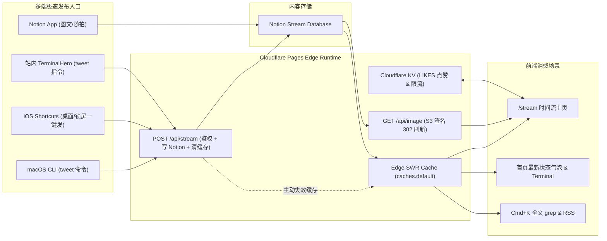

# Stream 短动态系统设计文档（Twitter / Memos 风格）

本文档记录 **Personal Portal (`pzhng.com`)** 新增短动态（代号 **Stream**）的设计思路、数据模型、边缘缓存与多端极速发布方案。

## 1. 核心设计原则

- **零元数据摩擦（Zero-Metadata Friction）**：发两句话不能像写 Blog 一样填 `Slug`、`Category`、`Date`、`Excerpt`。只保留 **1 个必填正文列（`Content`）**，时间戳、标签、摘要与图片防过期链接全部由系统自动派生。
- **全渠道 3 秒发布**：同时支持 **Notion 客户端**、**本地命令行 `tweet`**、**iPhone 锁屏/桌面快捷指令（iOS Shortcuts）** 以及 **站内 `TerminalHero`** 直接发送。
- **数据主权归属 Notion + 100% 复用现有边缘基建**：内容永久保存在你自己的 Notion Database 中；边缘读取复用 `withEdgeCache`、图片代理复用 `/api/image`（302 动态刷新预签名）、点赞防刷复用 `/api/likes` 与 Cloudflare KV。

---

## 2. 整体系统架构



---

## 3. Notion `Stream` Database 极简表结构

在 Notion 新建独立 Table Database（命名为 `Stream`）并授权给现有 Integration，仅需 4 列：

| 属性名 | Notion 类型 | 是否必填 | 设计说明 |
| :--- | :--- | :---: | :--- |
| **`Content`**（默认主列） | `Title` | **唯一必填** | 直接在标题列把几句话写完（支持多行、行内 `` `code` ``、代码块、URL 自动识别） |
| **`Images`** | `Files & media` | 可选 | 随手拖入 1–4 张配图或短视频，自动走 `/api/image?kind=stream` 防 S3 1 小时签名过期 |
| **`Pinned`** | `Checkbox` | 可选 | 勾选后在 `/stream` 顶部固定展示 `[PINNED]` 标记 |
| **`Published`** | `Checkbox` | 模板默认勾选 | 在 Notion 默认模板中设为已勾选（新建即发布）；取消勾选即为草稿 |

### 自动派生的隐式元数据（无需手填）
1. **精确到秒的时间戳**：直接读取 Notion Page 原生字段 `created_time`（ISO 8601 UTC 时间戳），前端据此渲染 `12m ago`、`3h ago` 及悬停精确时间。
2. **内联 `#hashtag` 标签解析**：直接在内容中写 `刚调通边缘缓存 #cloudflare #nextjs`，解析器自动提取标签数组，用于顶部筛选器与卡片内高亮染色。

---

## 4. 多端“3 秒发布”工作流

### 4.1 边缘写入网关 `POST /api/stream`
- **鉴权**：请求头 `Authorization: Bearer <STREAM_SECRET>`（使用 Web Crypto SHA-256 恒定时间摘要比对，配合同 IP 失败限流）。
- **写入**：调用 `@notionhq/client` 的 `pages.create` 写入 `Stream` Database（默认 `Published = true`）。
- **秒级生效**：写入成功后立即清除 Cloudflare Edge Cache 中的 `notion:stream:v1` 键，刷新页面 **0 秒延迟可见**；在 Notion 客户端直接编辑则走 2 分钟保鲜的 SWR 自动同步。

### 4.2 本地终端一行命令 (`~/.zshrc`)
```zsh
tweet() {
  curl -sS -X POST "https://pzhng.com/api/stream" \
    -H "Authorization: Bearer $PZHNG_STREAM_SECRET" \
    -H "Content-Type: application/json" \
    -d "$(jq -nc --arg text "$*" '{text: $text}')"
}
# 用法：tweet "把 Notion S3 签名过期问题用 302 Edge Proxy 彻底解了 #cloudflare"
```

### 4.3 iPhone 锁屏 / 桌面快捷指令（iOS Shortcuts）
1. 动作 1：**请求输入**（多行文本，提示 `What's on your mind?`）
2. 动作 2：**获取 URL 内容** → `POST https://pzhng.com/api/stream`，Header 带 `Authorization: Bearer <STREAM_SECRET>`，JSON Body `{ "text": "[提供的输入]" }`

### 4.4 站内首页 `TerminalHero`
- 访客命令：`stream`（在终端内打印最近 5 条短动态）
- 站长命令：`tweet <内容>`（从当前浏览器 `localStorage` 读取已保存的口令直接发布）

---

## 5. 前端交互与全站联动规范

1. **独立时间流主页 `/stream`（`app/stream/page.tsx`）**
   - 终端头部：`$ tail -f ./stream.log`
   - 顶部 `#tag` 聚合标签过滤栏（按频次排序，点击即时筛选）
   - 卡片结构：`@pzhng · 18m ago` + `[PINNED]` 徽章 + 轻量富文本（换行、行内代码、代码块、链接、`#tag`）+ 1–4 宫格图片/视频（点击复用 Lightbox 大图与 EXIF HUD）+ 底部 `LikeButton (type="stream")` 与单条锚点复制按钮（`/stream#id`）。
2. **首页实时状态条（`components/home/LatestThoughtBar.tsx`）**
   - 在 `TerminalHero` 正下方单行展示最新一条动态与相对时间（`● latest_thought · 18m ago: "..." → /stream`），让首页始终保持鲜活状态。
3. **全站打通**
   - `Navbar.tsx` 新增 `Stream` 导航项
   - `CommandPalette.tsx`（`⌘K` 全文搜索）同步检索最近短动态
   - 同步纳入 `sitemap.ts` 与 `feed.xml`

---

## 6. 待落地文件清单

| 模块 | 文件路径 | 说明 |
| :--- | :--- | :--- |
| **类型与工具** | `lib/types.ts`, `lib/utils.ts`, `lib/cache.ts` | 新增 `StreamItem` 类型、相对时间格式化 `formatRelativeTime`、Edge Cache 主动删除 `invalidateEdgeCache` |
| **Notion 读写层** | `lib/notion.ts` | 新增 `getStreamPosts()`、`createStreamPost()`、`#hashtag` 提取器及 `/api/image?kind=stream` 映射 |
| **边缘 API** | `app/api/stream/route.ts`, `app/api/image/route.ts`, `app/api/likes/route.ts`, `app/api/search/route.ts` | 实现 Stream 查询/鉴权发布接口，打通图片防过期、KV 点赞与 `⌘K` 搜索 |
| **页面与组件** | `app/stream/page.tsx`, `components/stream/StreamFeed.tsx`, `components/home/LatestThoughtBar.tsx` | `/stream` 主页（含轻量排版 + 多图 Lightbox）及首页实时状态条 |
| **导航与终端** | `components/layout/Navbar.tsx`, `components/home/TerminalHero.tsx`, `components/ui/CommandPalette.tsx`, `app/sitemap.ts` | 接入导航栏、首页交互终端 `stream` / `tweet` 命令与站点地图 |
| **环境配置** | `wrangler.toml`, `.env.example` | 配置 `NOTION_STREAM_DATABASE_ID`；通过 `wrangler pages secret put STREAM_SECRET` 注入发布口令 |
